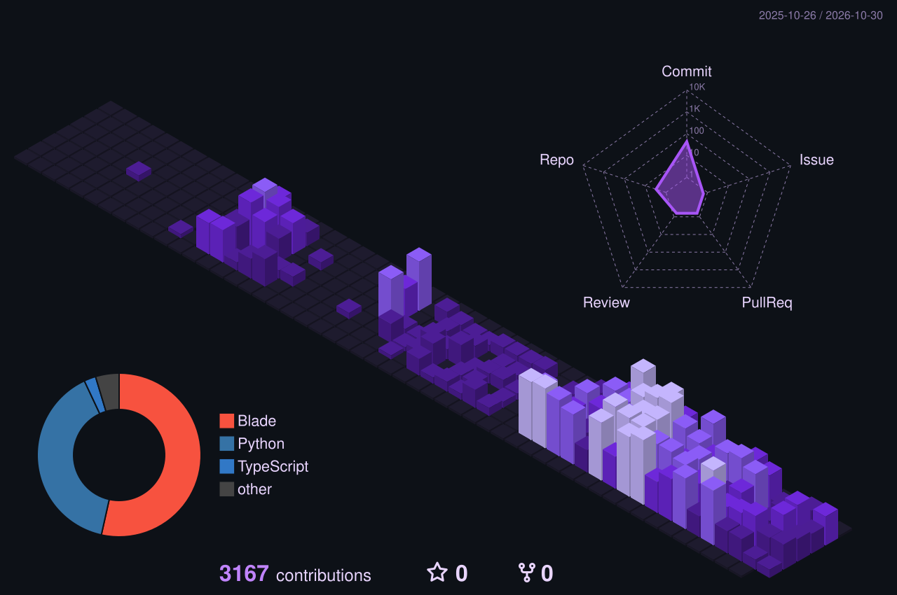

  

  

  
  
  
  

---

<table>
<tr>
<td width="52%" valign="top">

### Agora

Engenheiro de software na **Vector FIDC**, atuando no desenvolvimento da plataforma interna da empresa, do back-end ao front-end, com **Python (FastAPI)** e **React + TypeScript**.

### Antes

**Nóbrega Confecções**: desenvolvimento de sistemas internos com Laravel.

</td>
<td width="48%" valign="top">

<picture>
  <source media="(prefers-color-scheme: dark)" srcset="./profile-3d-contrib/profile-purple-dark.svg" />
  <source media="(prefers-color-scheme: light)" srcset="./profile-3d-contrib/profile-purple-light.svg" />
  
</picture>

</td>
</tr>
</table>

### Tecnologias

  

### Projetos de estudo

O código do trabalho é privado. Estes são projetos pessoais e de estudo:

| Projeto | O que é | Stack |
|---|---|---|
| [**ans-pipeline-dados**](https://github.com/ThiagoRodrigues11/ans-pipeline-dados) | Coleta e tratamento de dados públicos da ANS: download via API, validação de CNPJ, modelagem em SQL e API com interface |    |
| [**task-manager-fullstack**](https://github.com/ThiagoRodrigues11/task-manager-fullstack) | Gerenciador de tarefas com autenticação JWT, tudo em Docker Compose |     |
| [**api-catalogo-produtos**](https://github.com/ThiagoRodrigues11/api-catalogo-produtos) | API REST de produtos e categorias, com upload de imagens e envio de e-mail |   |

  

